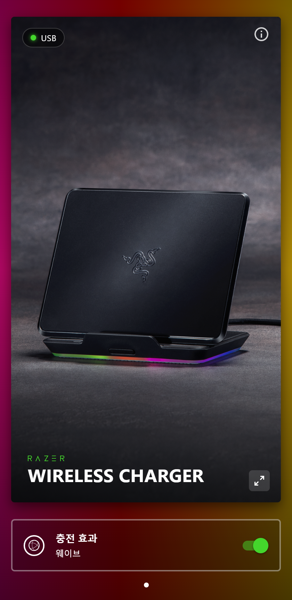
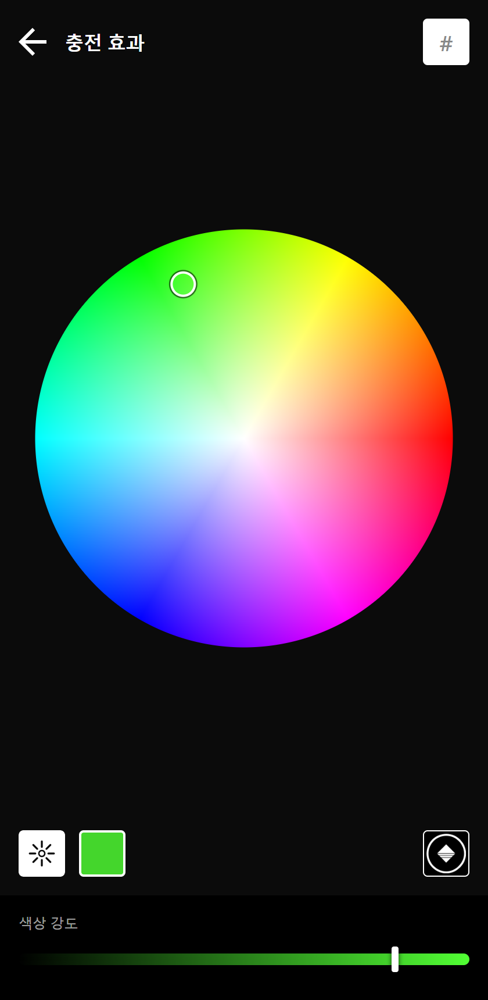
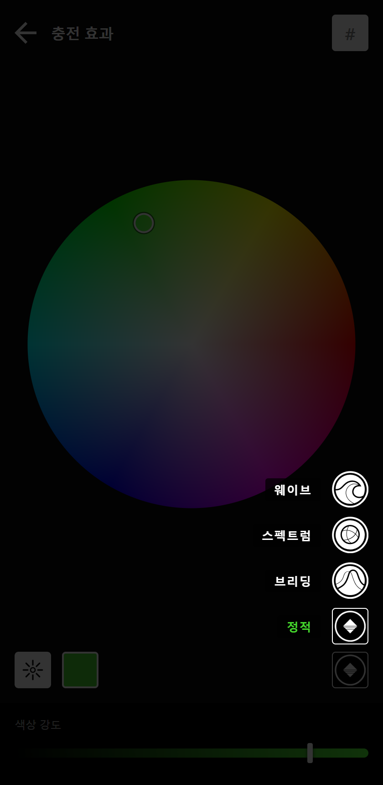
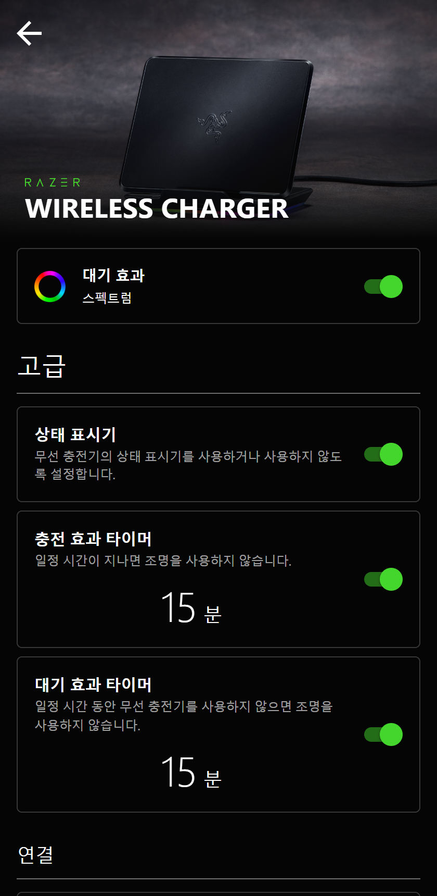

# Razer 무선 충전기 크로마 — PC 프로그램

Razer Chroma 무선 충전기(Razer Wireless Charger)의 조명을 Windows PC에서 바꾸는 비공식 프로그램입니다.
안드로이드 앱 **Razer Chroma Configurator**와 같은 화면으로 열리고, **USB** 또는 **블루투스**로 충전기와 통신합니다.

> Razer와 관계없는 개인 프로젝트입니다. Razer·Chroma 이름과 화면에 쓴 충전기 사진·아이콘·로고는 Razer Inc.의 것입니다.
> 권리자가 요청하면 내리겠습니다.

| 첫 화면 | 색 편집 | 효과 고르기 | 고급 설정 |
|:---:|:---:|:---:|:---:|
|  |  |  |  |
| 충전기를 USB로 연결한 모습, 충전 효과 켜고 끄기 | 색상환·색 코드·밝기·색상 강도 | 정적·브리딩·스펙트럼·웨이브 | 대기 효과, 상태 표시기, 조명 꺼짐 타이머 |

## 내려받기
[Releases](../../releases)에서 `RazerChargerChroma.zip`을 받아 **압축을 푼 뒤** `RazerChargerChroma.exe`를 실행하세요.
압축 파일 안에서 바로 실행하면 필요한 파일이 빠져 실행되지 않습니다.

- 처음 실행할 때 "Windows의 PC 보호" 창이 뜨면 "추가 정보" → "실행"을 누르세요. (서명하지 않은 프로그램이라 뜹니다)
- 바탕화면 바로가기가 필요하면 `바탕화면 바로가기 만들기.bat`을 실행하세요.
- 필요한 환경: Windows 10 / 11 (64비트), Microsoft Edge WebView2 런타임(Windows 11과 최신 Windows 10에는 이미 들어 있음)

## 연결
- **USB (권장)**: 충전기 케이블을 PC USB 포트에 꽂으면 자동으로 잡힙니다. 페어링이 필요 없고, 충전기에 지금 설정된 효과를 읽어 와 보여 줍니다.
- **블루투스**: USB로 연결되어 있지 않을 때 씁니다. 충전기는 기기 하나만 기억하므로, 처음 한 번은 충전기 버튼을 **5~6초 길게 눌러 페어링 모드**로 만든 뒤
  "고급 → 블루투스 → 연결"을 누르세요. 이렇게 하면 폰과의 블루투스 연결은 끊어집니다.

## 화면
- 첫 화면: 충전기 카드와 **충전 효과** 줄. 줄을 누르면 색 편집, 오른쪽 스위치로 켜고 끄기, 오른쪽 아래 버튼은 고급 설정입니다.
- 색 편집: 색상환을 누르거나 끌어 색 고르기, `#` 칸에 색 코드 입력, 왼쪽 아래 ☀ = LED 밝기,
  오른쪽 아래 버튼 = 효과(정적·브리딩·스펙트럼·웨이브). 바꾸면 바로 충전기에 적용됩니다.
- 고급: **대기 효과**(폰을 올려 두지 않았을 때 조명), 상태 표시기, 효과 타이머, 연결 정보, 기기 설정 초기화, 통신 기록.

## 알아 둘 것
- **절전**: 대기 효과 타이머(기본 15분)가 지나 조명이 꺼지면 충전기가 잠들어 USB 명령을 받지 않습니다.
  화면에 "절전 중"이 뜨면 충전기 버튼을 누르거나 폰을 올려 두세요. 그사이 바꾼 설정은 충전기가 깨어나면 적용됩니다.
- 상태 표시기·타이머·초기화는 **블루투스로 연결했을 때만** 바뀝니다(USB 명령을 찾지 못함).
- 설정과 통신 기록은 `%LOCALAPPDATA%\RazerChargerChroma`에 저장됩니다.
- 확인한 충전기: 펌웨어 v0.10 (USB `VID 1532 / PID 902A`).

## 직접 빌드하기
- `src\build.bat`: Windows에 들어 있는 C# 컴파일러(.NET Framework 4.x)로 `RazerChargerChroma.exe`를 만듭니다. 따로 설치할 것은 없습니다.
  `lib\`의 WebView2 DLL을 exe 옆으로 복사합니다.
- `tools\package.bat`: 실행에 필요한 파일만 모아 `공유용\RazerChargerChroma.zip`을 만듭니다.

## 폴더
| 폴더·파일 | 내용 |
|---|---|
| `src\` | 프로그램 소스(C#, WinForms + WebView2), USB(HID)·블루투스 LE 통신 |
| `ui\` | 화면(HTML·CSS·JS)과 그림 |
| `lib\` | Microsoft WebView2 SDK DLL |
| `tools\` | 공유용 zip 만들기, 받는 사람용 사용법 |
| `브라우저판\` | 이전에 만든 웹 페이지판(Edge·Chrome의 웹 블루투스로 연결) |
| [`프로토콜.md`](프로토콜.md) | USB 기능 보고서·블루투스 LE 명령 정리 |

## 라이선스
- 이 저장소의 코드: [MIT](LICENSE)
- `lib\`의 Microsoft WebView2 SDK: BSD 라이선스 ([lib/WebView2-LICENSE.txt](lib/WebView2-LICENSE.txt))
- `ui\img\`의 충전기 사진·아이콘·Razer 로고는 Razer Inc.의 자료이며 MIT 라이선스에 포함되지 않습니다.
